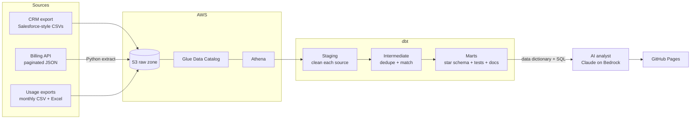
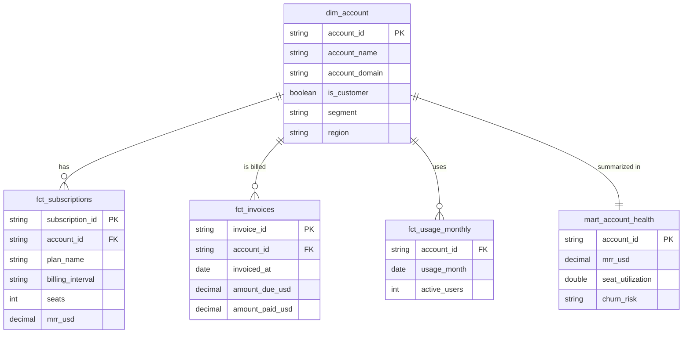

# Loopwise Customer 360: making messy SaaS data AI-ready on AWS

**[Watch the 4-minute walkthrough](https://julianneitliong.github.io/customer-360/#walkthrough)** · **[Live demo: the AI analyst](https://julianneitliong.github.io/customer-360/)** · **[Data dictionary and lineage (dbt docs)](https://julianneitliong.github.io/customer-360/dbt/index.html)**

Loopwise, a fictional B2B SaaS project-management company, wants to onboard to an AI analytics product that builds dashboards for its business users. Its customer data is split across three systems that don't agree with each other: a **CRM**, a **billing tool** and **product-usage exports**.

This project ingests all three into AWS, cleans and matches them with dbt, tests and documents every table, and then lets an AI model (Claude on Amazon Bedrock) answer business questions from the result, such as *"What is current MRR by region?"* and *"Which customers pay for seats they don't use?"*

All data is synthetic, generated with the problems real data has. See [`data/DATA_ISSUES.md`](data/DATA_ISSUES.md).

## Architecture



| Layer | Tool | What happens |
|---|---|---|
| Extract and load | Python, boto3 | Pull the billing API page by page; upload all files to S3 (Excel converted to CSV) |
| Raw (bronze) | S3, Glue Data Catalog, Athena | Files registered as tables; every CSV column read as a string so nothing is lost |
| Staging (silver) | dbt views | Clean each source: IDs, types, dates, currencies, category values |
| Intermediate (silver) | dbt views | Remove duplicate accounts; match billing and usage records to CRM accounts |
| Marts (gold) | dbt tables (Parquet) | Star schema plus one account-health table for the AI |
| AI analyst | Amazon Bedrock, Athena | Claude reads the data dictionary, writes read-only SQL, and explains the result |

## The data problems, and how they were solved

| Problem | Fix |
|---|---|
| Salesforce IDs exported as both 15 and 18 characters | Standardized on the first 15 characters (the 18-character ID is the 15 plus a checksum); kept case-sensitive |
| 4 duplicate CRM accounts | `row_number()` over the cleaned domain, keeping the oldest record: 64 rows became 60 companies |
| Billing has its own customer IDs; CRM ID present for only 38 of 56 customers | Match on CRM ID first, then on email domain: 54 of 56 matched |
| Usage files only have a domain, in mixed formats | Cleaned the domain and matched it to the CRM: 504 of 524 monthly rows matched |
| Usage export format changed in May; July sent twice; two months in Excel | One table reads both formats; duplicates removed using the source file name (`"$path"`) |
| Amounts in cents and in USD, EUR and GBP | Converted to dollars, then to USD with an exchange-rate seed |
| "Team" plan renamed "Pro" mid-year | Standardized to Pro, and a test confirms "Team" no longer appears |
| Records that can't be matched | Kept in `int_unmatched_records` with a reason, never silently dropped |

## Data model



`dim_account` is the parent; each fact table is a child linked by `account_id`. `mart_account_health` puts everything the AI needs most often into one row per account.

**Business rules** (also written into the column descriptions, so the AI uses them):
- **MRR** = seats × price per seat, converted to USD. Annual plans are divided by 12. Only active subscriptions count toward current MRR.
- **Churn risk:** *Churned* = no active subscription. *High* = under 35% of paid seats used, or active users down 30% or more in 3 months. *Medium* = under 60% of seats used. *Low* = everyone else.

## Data quality: 27 dbt tests

- **Keys:** primary keys are unique and never empty (no double counting from joins).
- **Relationships:** every subscription, invoice and usage row links to an account that exists.
- **Allowed values:** segment, region, plan, billing interval and churn risk only contain expected values.
- **Custom tests:** MRR is never negative; each billing customer is matched exactly once.

## The AI analyst

[`scripts/ai_analyst.py`](scripts/ai_analyst.py) sends Claude (on Amazon Bedrock) the table and column descriptions from dbt plus a business question. Claude writes one SQL query, the script runs it on Athena, and Claude explains the result using only the numbers returned.

Guardrails:
- **Read-only:** a query must start with `SELECT` or `WITH`, contain one statement, and no data-changing keywords. Anything else is blocked before it reaches Athena.
- **Grounded answers:** the explanation step only sees the query result, so it can't invent figures.
- **Self-correction:** if a query fails, the error goes back to the model for one retry.

The results are published on the [demo page](https://julianneitliong.github.io/customer-360/).

## Run it yourself

### Part 1: In the AWS console (one time)
1. Sign in and pick one region (for example **US West (Oregon) us-west-2**). Use it for everything.
2. **Billing and Cost Management > Budgets > Create budget**: a monthly cost budget of $5 with an email alert.
3. **IAM > Users > Create user** (for example `julianne-dev`). Attach `AmazonS3FullAccess`, `AmazonAthenaFullAccess`, `AWSGlueConsoleFullAccess` and `AmazonBedrockFullAccess`.
4. Open that user > **Security credentials > Create access key** (use case: Command Line Interface). Save the key and secret somewhere safe. Never commit them to GitHub.
5. **S3 > Create bucket**: a globally unique name such as `loopwise-customer360-<yourname>`, same region, keep "Block all public access" on.
6. In the bucket, create a folder named `athena-results/`.
7. **Athena > Query editor > Settings > Manage**: set the query result location to `s3://<your-bucket>/athena-results/`.
8. **Amazon Bedrock > Model catalog**: choose a Claude model, submit the Anthropic use-case form if asked, and copy the model's inference profile ID.

### Part 2: Ingest (Python, Python 3.12+)
Install the AWS CLI (`brew install awscli`), run `aws configure` with the access key, then:
```bash
python3 -m venv .venv
source .venv/bin/activate
pip install -r requirements.txt
python scripts/generate_data.py
```
Start the mock billing API in a second terminal and leave it running:
```bash
python -m http.server 8000 --directory mock_api
```
Back in the first terminal:
```bash
python scripts/extract_billing.py
python scripts/load_to_s3.py --bucket <your-bucket>
```
Then run each statement in [`sql/athena/01_create_raw_tables.sql`](sql/athena/01_create_raw_tables.sql) in the Athena query editor, one at a time.

### Part 3: Transform (dbt, in its own Python 3.12 environment)
dbt Core 1.12 does not yet support Python 3.14, so it gets a separate environment:
```bash
python3.12 -m venv .venv-dbt
source .venv-dbt/bin/activate
pip install -r requirements-dbt.txt
cd loopwise_dbt
cp profiles.example.yml profiles.yml
dbt seed
dbt run
dbt test
dbt docs generate
```

### Part 4: AI analyst (back in `.venv`, from the repo root)
```bash
python scripts/ai_analyst.py --bucket <your-bucket> --model-id <inference profile ID>
```

## Repo layout
```
scripts/          Python: generate data, extract from the billing API, load to S3, AI analyst
mock_api/         Mock billing API responses (paginated JSON)
data/landing/     Files as they arrive from each source (before S3)
data/answer_key/  Ground truth for checking the matching (not loaded)
sql/athena/       Raw table definitions and checks
loopwise_dbt/     dbt project: staging, intermediate and marts models, tests, seed
docs/             GitHub Pages site: AI analyst results and dbt docs
```

## Decisions and trade-offs
- **Athena over a database server:** the work is read-heavy analytics on small files, so a serverless, pay-per-query engine costs pennies and fits an ELT approach.
- **Hand-written table definitions over a Glue crawler:** full control over types; raw columns stay strings until staging.
- **Simple, explainable churn rules over a model:** business users and the AI can both understand and check them.
- **Pre-generated AI answers on a static page:** a public page with a live model would expose API credentials.

## Future improvements
- Orchestrate the pipeline (Step Functions or Airflow) and run dbt tests in CI on every pull request
- Partition large tables by month and load incrementally
- Daily exchange rates instead of a fixed seed
- Proration and mid-month plan changes in MRR
- Upgrade to dbt v2
- Next project: unstructured text (support tickets and survey comments)

---

Built by [Julianne Itliong](https://www.linkedin.com/in/julianneitliong/).
